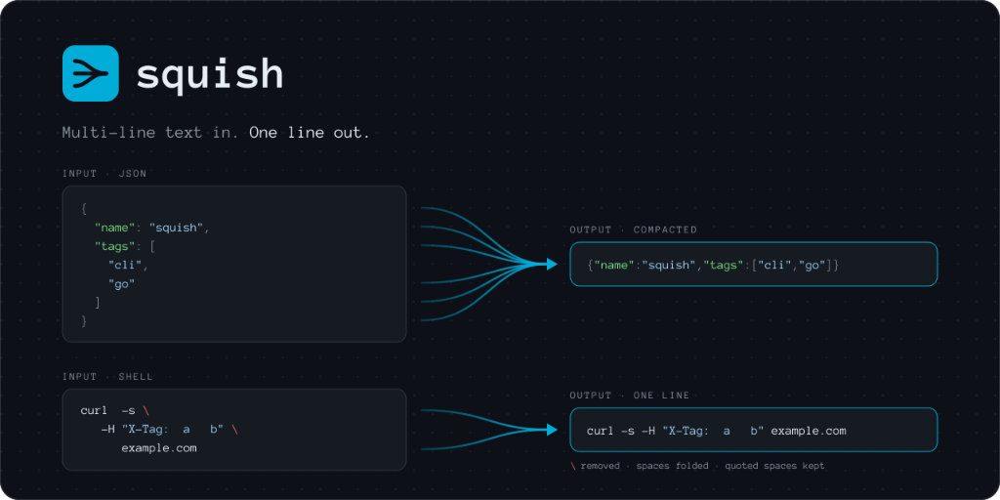

# squish



`squish` turns multi-line text into a single line.

Pass the text as an argument, or pipe it on stdin:

```bash
squish 'docker run \
  -it \
  ubuntu'

pbpaste | squish
```

## Install

```bash
go install github.com/KrawMire/squish@latest
```

From a checkout of this repo, `go install .` installs the current code. The binary lands in `$(go env GOPATH)/bin`.

## What it does

A JSON object or array is compacted:

```bash
squish '{
  "name": "squish",
  "ok": true
}'
# {"name":"squish","ok":true}
```

Other text loses shell line-continuations, and whitespace outside quotes is folded into one space. Spaces inside quotes stay put:

```bash
squish 'echo "hello   world" \
  foo'
# echo "hello   world" foo
```

## Options

`-raw` folds whitespace even when the input is JSON.

`-sep` joins trimmed lines with a separator other than a space. Empty lines are dropped. JSON is not compacted when `-sep` is set.

```bash
squish -sep '; ' 'one
two
three'
# one; two; three
```

`squish -h` prints the same usage text.
